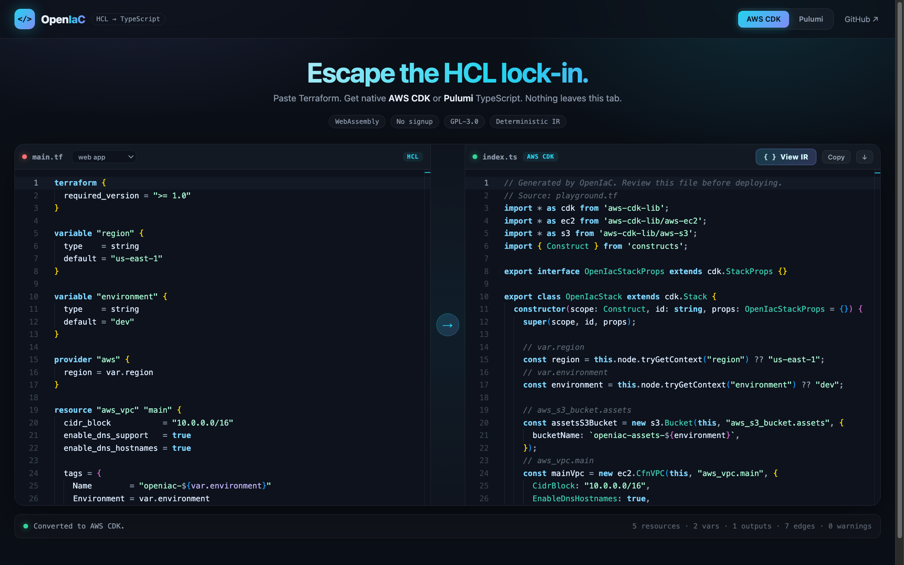
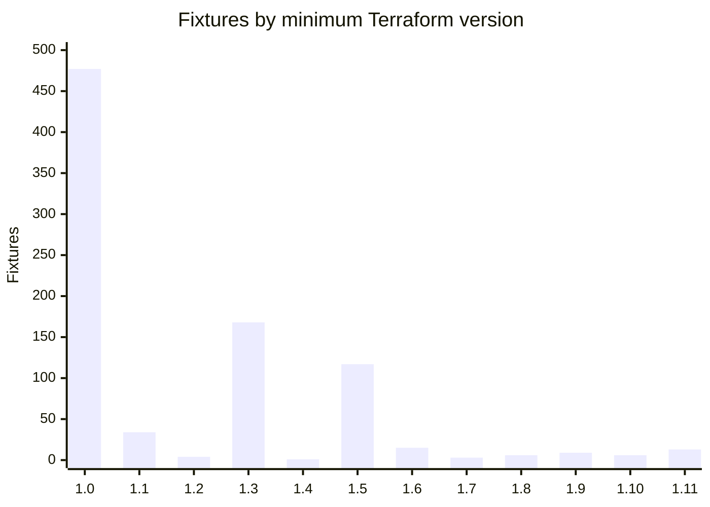

<div align="center">

# OpenIaC

### Terraform in. Native TypeScript out.

**The open-source HCL → AWS CDK / Pulumi transpiler.**<br/>
One parser. One IR. Zero lock-in.

<br/>

[](#-license)
[](https://go.dev)
[](playground/)
[](#-timeline)
[](#-contributing)

[](docs/TERRAFORM-VERSIONS.md)
[](https://aws.amazon.com/cdk/)
[](https://www.pulumi.com/)
[](https://openiac.codewithzeal.com)
[](docs/IR.md)
[](https://go.dev)

<br/>

**`terraform`** · **`hcl`** · **`hcl2`** · **`aws-cdk`** · **`pulumi`** · **`infrastructure-as-code`** · **`iac`** · **`transpiler`** · **`codemod`** · **`typescript`** · **`webassembly`** · **`devops`** · **`cloudformation`** · **`aws`** · **`golang`**

<br/>

[🚀 Live demo · open beta](https://openiac.codewithzeal.com) · [📦 Quick Start](#-quick-start) · [🗺️ Roadmap](docs/ROADMAP.md) · [🧠 How It Works](#-how-it-works) · [🧱 Architecture](docs/ARCHITECTURE.md) · [📄 IR Reference](docs/IR.md) · [🧭 Version Support](docs/TERRAFORM-VERSIONS.md) · [🧪 Conformance](docs/CONFORMANCE.md) · [🤝 Contribute](CONTRIBUTING.md)

<br/>

### ⚡ Open beta — try it right now

[](https://openiac.codewithzeal.com)
[](https://openiac.codewithzeal.com)
[](https://openiac.codewithzeal.com)

<a href="https://openiac.codewithzeal.com">
  
</a>

<sub>No install, no account, nothing leaves your tab.</sub>

<br/><br/>

<a href="https://openiac.codewithzeal.com"><b>▶ Click here to get open beta access</b></a>

</div>

---

## 🎯 The Aim

<table>
<tr>
<td width="33%" valign="top">

### 🔓 Break the lock-in

Your infrastructure is described in HCL. Your platform team writes TypeScript. OpenIaC translates one into the other — **structurally**, not with regex.

</td>
<td width="33%" valign="top">

### 🧠 Keep the meaning

Parsing happens with HashiCorp's own `hcl/v2` library. Dependencies become a real DAG. References are rewritten to the *target's* identifiers.

</td>
<td width="33%" valign="top">

### 🌍 Run anywhere

The same engine powers a CLI, a Go library, and a **zero-install browser playground** compiled to WebAssembly.

</td>
</tr>
</table>

> **One sentence:** migrate from Terraform to AWS CDK or Pulumi without hand-porting a thousand lines of HCL.

---

## 🤞 The Promises

| Promise | What it means |
|:--|:--|
| 🔒 **Nothing leaves your machine** | The playground runs the entire compiler in your browser tab. No account, no upload, no telemetry. |
| 🎯 **Deterministic output** | Same input → byte-identical TypeScript. Stable topological ordering with cycle detection. |
| 🧱 **Readable code, not spaghetti** | Named identifiers, typed variables, import blocks grouped by module — code a human would have written. |
| ⚠️ **Warnings over silence** | Unsupported constructs (`count`, `for_each`, modules) are flagged loudly. Never silently dropped. |
| 🧩 **Mappings are data** | Add a resource by editing [`aws.json`](pkg/mappings/aws.json) — no Go required. |
| 🪪 **Honest licensing** | GPL-3.0. Fork it, audit it, ship it. |

---

## ⚡ Quick Start

<table>
<tr><td>

**1 · Build the CLI**

```bash
git clone https://github.com/be-thomas/OpenIaC.git
cd OpenIaC
make build
```

</td><td>

**2 · Convert a module**

```bash
./bin/openiac convert ./examples/aws-web-app \
  --target both
```

</td><td>

**3 · Inspect the IR**

```bash
./bin/openiac ir ./examples/aws-web-app \
  | jq '.resources[].id'
```

</td></tr>
</table>

```text
openiac convert ./examples/aws-web-app --target both --stdout
```

<table>
<tr>
<td width="50%" valign="top">

**AWS CDK**

```ts
const mainVpc = new ec2.CfnVPC(this, "mainVpc", {
  cidrBlock: "10.0.0.0/16",
  enableDnsSupport: true,
  tags: [{ key: "Name", value: `openiac-${environment}` }],
});
```

</td>
<td width="50%" valign="top">

**Pulumi**

```ts
const mainVpc = new aws.ec2.Vpc("mainVpc", {
  cidrBlock: "10.0.0.0/16",
  enableDnsSupport: true,
  tags: { Name: `openiac-${environment}` },
});
```

</td>
</tr>
</table>

### 🖥️ Browser playground

Live at **[openiac.codewithzeal.com](https://openiac.codewithzeal.com)** — open
beta, no account. To run it yourself:

```bash
make wasm                                        # builds main.wasm + wasm_exec.js
python3 -m http.server -d playground 8080        # serve it
```

Open `http://localhost:8080`, paste Terraform, get TypeScript. **No backend.**
Press **View IR** in the output pane to inspect the intermediate representation
both emitters share; **Hide IR** returns to the generated TypeScript.

---

## 🧠 How It Works

Terraform **1.0–1.17** configuration parses in both syntaxes; conversion covers
a documented subset of it. Anything outside that subset is preserved in the IR
and reported as a coded warning, never silently dropped.

```text
┌──────────────┐     ┌──────────────┐     ┌──────────────┐     ┌──────────────┐
│  Terraform   │     │   Universal  │     │  Dependency  │     │   Native TS  │
│     HCL      │ ──▶ │      IR      │ ──▶ │     DAG      │ ──▶ │   emitters   │
│.tf / .tf.json│     │  JSON-shaped │     │  topo-sorted │     │ CDK / Pulumi │
└──────────────┘     └──────────────┘     └──────────────┘     └──────────────┘
       ▲                    ▲                    ▲                     ▲
   hcl/v2 parser      resources+vars        Kahn's algorithm      JSON mappings
    HCL + JSON         + preserved blocks
```

<table>
<tr>
<th align="left">Stage</th>
<th align="left">Package</th>
<th align="left">Job</th>
</tr>
<tr>
<td><b>Parse</b></td>
<td><a href="pkg/parsers/hcl/"><code>pkg/parsers/hcl</code></a></td>
<td>Reads native HCL and JSON (<code>.tf</code> and <code>.tf.json</code>) for every Terraform 1.0–1.17 top-level block. Constructs without a target mapping are preserved, never dropped — see <a href="docs/TERRAFORM-VERSIONS.md">version support</a>.</td>
</tr>
<tr>
<td><b>Resolve</b></td>
<td><a href="pkg/ir/"><code>pkg/ir</code></a></td>
<td>Builds edges from traversals, sorts topologically, reports cycles with the offending path.</td>
</tr>
<tr>
<td><b>Map</b></td>
<td><a href="pkg/mappings/"><code>pkg/mappings</code></a></td>
<td>Looks up a resource's target class, property names, block shapes and output attributes.</td>
</tr>
<tr>
<td><b>Rewrite</b></td>
<td><a href="pkg/emitutil/"><code>pkg/emitutil</code></a></td>
<td>Turns <code>aws_vpc.main.id</code> into <code>mainVpc.ref</code> (CDK) or <code>mainVpc.id</code> (Pulumi) — including inside templates.</td>
</tr>
<tr>
<td><b>Emit</b></td>
<td><a href="pkg/emitters/"><code>pkg/emitters</code></a></td>
<td>Generates a complete, compilable TypeScript file per target.</td>
</tr>
</table>

---

## 📊 Feature Matrix

| Capability | AWS CDK | Pulumi | Status |
|:--|:--:|:--:|:--|
| Resources (L1 / L2 constructs) | ✅ | ✅ | **Stable** |
| Variables → context / config | ✅ | ✅ | **Stable** |
| Outputs | ✅ | ✅ | **Stable** |
| Interpolated strings & templates | ✅ | ✅ | **Stable** |
| Object & list literals | ✅ | ✅ | **Stable** |
| `depends_on` | ✅ | ✅ | **Stable** |
| Security group blocks | ✅ | ✅ | **Stable** |
| Provider alias | ✅ | ✅ | Partial |
| Data sources | ⚠️ | ⚠️ | Warned |
| `count` / `for_each` | ⚠️ | ⚠️ | Warned |
| `locals` | ⚠️ | ⚠️ | Warned |
| Modules | ⚠️ | ⚠️ | Warned |
| Non-AWS providers | ⚠️ | ⚠️ | Warned |

> Legend: ✅ emitted · ⚠️ converted with an explicit warning · ❌ not yet

---

## 🧩 Resource Coverage

<sub>14 AWS resources mapped out of the box · **add more in one JSON edit**</sub>

| Terraform | AWS CDK construct | Level | Pulumi class |
|:--|:--|:--:|:--|
| `aws_vpc` | `ec2.CfnVPC` | L1 | `ec2.Vpc` |
| `aws_subnet` | `ec2.CfnSubnet` | L1 | `ec2.Subnet` |
| `aws_security_group` | `ec2.CfnSecurityGroup` | L1 | `ec2.SecurityGroup` |
| `aws_internet_gateway` | `ec2.CfnInternetGateway` | L1 | `ec2.InternetGateway` |
| `aws_route_table` | `ec2.CfnRouteTable` | L1 | `ec2.RouteTable` |
| `aws_eip` | `ec2.CfnEIP` | L1 | `ec2.Eip` |
| `aws_instance` | `ec2.CfnInstance` | L1 | `ec2.Instance` |
| `aws_s3_bucket` | `s3.Bucket` | **L2** | `s3.Bucket` |
| `aws_sns_topic` | `sns.Topic` | **L2** | `sns.Topic` |
| `aws_sqs_queue` | `sqs.CfnQueue` | L1 | `sqs.Queue` |
| `aws_dynamodb_table` | `dynamodb.CfnTable` | L1 | `dynamodb.Table` |
| `aws_lambda_function` | `lambda.CfnFunction` | L1 | `lambda.Function` |
| `aws_iam_role` | `iam.CfnRole` | L1 | `iam.Role` |
| `aws_cloudwatch_log_group` | `logs.CfnLogGroup` | L1 | `cloudwatch.LogGroup` |

<details>
<summary><b>➕ Adding a resource (no Go required)</b></summary>

<br/>

```json
{
  "aws_kms_key": {
    "cdk": {
      "kind": "l1",
      "module": "aws-kms",
      "class": "CfnKey",
      "properties": { "description": "description" },
      "attributes": { "arn": "attrArn", "key_id": "attrKeyId" }
    },
    "pulumi": {
      "module": "kms",
      "class": "Key",
      "properties": { "description": "description" }
    }
  }
}
```

Add it to [`pkg/mappings/aws.json`](pkg/mappings/aws.json), rebuild, done.

</details>

---

## 🖥️ CLI Reference

| Command | Purpose |
|:--|:--|
| `openiac convert <file\|dir>` | Transpile Terraform into TypeScript |
| `openiac ir <file\|dir>` | Dump the universal JSON IR |
| `openiac version` | Print the version |

| Flag | Default | Meaning |
|:--|:--|:--|
| `--target` | `cdk` | `cdk`, `pulumi`, or `both` |
| `--out` | `out` | Output directory |
| `--stack` | `OpenIacStack` | Generated CDK stack class |
| `--stdout` | `false` | Print instead of write |
| `--json` | `false` | Machine-readable result |
| `-o` | — | IR output file (`ir` only) |

<details>
<summary><b>🧾 Example IR</b></summary>

<br/>

```json
{
  "version": "0.2",
  "resources": [
    {
      "id": "aws_vpc.main",
      "type": "aws_vpc",
      "name": "main",
      "attributes": { "cidr_block": { "kind": "string", "literal": "10.0.0.0/16" } }
    }
  ],
  "min_version": "1.0.0",
  "edges": [{ "from": "aws_subnet.public", "to": "aws_vpc.main", "kind": "reference" }]
}
```

`from` depends on `to`. Every field, value kind and guarantee is documented in
[docs/IR.md](docs/IR.md).

</details>

---

## 🧪 Conformance Corpus

The transpiler is tested against real Terraform, not hand-written examples. The
repository vendors **853 modules** (6,471 files, ~23 MiB) from the Terraform
Registry and public GitHub repositories. Every fixture pins the resolved upstream
commit, records the input-tree hash, carries the upstream license and is scanned
for executables and credentials before it enters the tree. CI re-verifies the
tree, its lock and the generated attribution on every pull request.

[](conformance/status.json)

<!-- conformance:summary:start -->

<!-- conformance:summary:end -->

Every one of the 853 modules parses into schema `0.2` IR. The chart groups each
module by the oldest Terraform release its configuration needs; the exact
distribution is in [`conformance/status.json`](conformance/status.json), which
`make conformance-status` regenerates and CI checks.

```bash
make conformance-inputs                 # refresh from configured sources
make conformance-verify                 # check the committed tree and lock
make conformance-lock                   # regenerate the lock and attribution
make conformance-status                 # re-parse the corpus, refresh the summary
cat conformance/corpus.lock.json        # aggregate counts and tree hash
```

| Tier | Count | Purpose |
|:--|--:|:--|
| `smoke` | 20 | Smallest basic modules, for every pull request |
| `core` | 0 | Resources, variables and outputs only |
| `advanced` | 487 | Data sources, locals, expressions, `count`/`for_each` |
| `modules` | 346 | Module composition |

Every basic module was small enough to enter `smoke`, so `core` is currently
empty. Tier is metadata rather than a directory, and both the smoke set and the
other tiers are derived deterministically; CI rejects a hand-edited tier.

See [docs/CONFORMANCE.md](docs/CONFORMANCE.md) for the L0–L4 oracle design and
[conformance/README.md](conformance/README.md) for provenance and regeneration.

---

## 🗺️ Timeline

| Milestone | Date | Highlights | State |
|:--|:--|:--|:--:|
| **Foundation** | Oct 2026 | HCL parser · IR · DAG · CDK + Pulumi emitters · WASM playground | ✅ |
| **v0.1 Public Alpha** | Nov 2026 | Docs incl. [IR](docs/IR.md) & [version](docs/TERRAFORM-VERSIONS.md) references · tests · CI · Cloudflare Workers playground | 🚧 |
| **v0.2 Depth** | Dec 2026 | Data sources · `locals` · richer L2 mappings | ⏳ |
| **v0.3 Scale** | Q1 2027 | Modules · `count` / `for_each` · multi-file imports | ⏳ |
| **v1.0 Stable** | Q2 2027 | CloudFormation + Terraform backends · plugin API | 🎯 |
| **v1.x Expansion** | 2027+ | Azure/Bicep · GCP · Kubernetes · Python & Go emitters | 🌅 |

```text
Oct 2026      Nov 2026      Dec 2026      Q1 2027       Q2 2027       2027+
  ✅ ─────────  🚧 ─────────  ⏳ ─────────  ⏳ ─────────  🎯 ─────────  🌅
 core      alpha release   data+locals    modules       v1.0       more clouds
```

---

## 🗂️ Project Layout

```text
OpenIaC/
├── cmd/
│   ├── openiac/              CLI entry point
│   └── openiac-conformance/  Corpus collector and harness CLI
├── conformance/
│   ├── fixtures/             Vendored Terraform inputs with provenance
│   └── collection/           Source seeds, caps and license allowlist
├── internal/conformance/     Collector and conformance layers
├── pkg/
│   ├── ir/               Universal graph + topological sort
│   ├── parsers/hcl/      HCL2 and JSON → IR
│   ├── tfversion/        Terraform language version detection
│   ├── mappings/         Data-driven aws.json registry
│   ├── emitutil/         Naming, rewriting, rendering
│   ├── emitters/         aws-cdk/ + pulumi/ (+ shared warnings)
│   └── engine/           Orchestration
├── docs/                 Architecture, IR, versions, conformance, roadmap
├── wasm/                 js/wasm entry point
├── playground/           Monaco + WASM UI
├── examples/             Sample Terraform modules
└── Makefile
```

---

## 🤝 Contributing

| Step | Command |
|:--|:--|
| 1 · Fork & clone | `git clone https://github.com/<you>/OpenIaC.git` |
| 2 · Build | `make build` |
| 3 · Test | `make test` |
| 4 · Lint | `make vet && gofmt -l .` |
| 5 · Rebuild WASM | `make wasm` |
| 6 · Open a PR | — |

**Good first issues:** new resource mappings · [conformance fixtures](docs/CONFORMANCE.md) · better warning messages · playground presets.

---

## ❓ FAQ

<details>
<summary><b>Is OpenIaC a Terraform replacement?</b></summary>
No. It reads existing Terraform and produces CDK or Pulumi code. State, providers and planning stay with the target tool.
</details>

<details>
<summary><b>Does the playground upload my code?</b></summary>
No. The parser and emitters are compiled to WebAssembly and run inside the tab. There is no server component.
</details>

<details>
<summary><b>Is the output production-ready?</b></summary>
Treat it as a migration accelerator: review the generated stack, then `cdk synth` / `pulumi preview`. Warnings tell you exactly what needs a human.
</details>

<details>
<summary><b>Can I use it as a Go library?</b></summary>
Yes — <code>engine.ConvertSource</code> and <code>engine.Convert</code> are the entry points. The IR is plain Go structs with JSON tags.
</details>

<details>
<summary><b>Why GPL-3.0?</b></summary>
The venture stays open: improvements to the compiler come back to the commons.
</details>

---

## 📄 License

[GNU General Public License v3.0](LICENSE) © OpenIaC contributors

<div align="center">

<sub>
OpenIaC is an independent project. Not affiliated with, endorsed by, or sponsored by<br/>
HashiCorp, Amazon Web Services, or Pulumi Corporation.<br/>
Terraform, AWS CDK and Pulumi are trademarks of their respective owners.
</sub>

<br/><br/>

**If this saves you a migration, star the repo ⭐**

</div>
